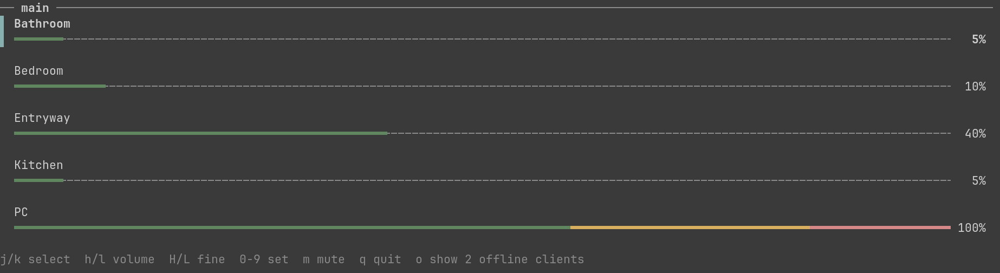

# snapvol

Small program to adjust [Snapcast](https://github.com/badaix/snapcast) volume using [python-snapcast](https://github.com/happyleavesaoc/python-snapcast).

## Usage

### CLI

```
usage: snapvol [-h] [-H HOST] [-V] ACTION ...

Control Snapcast volume

positional arguments:
  ACTION
    list (l)         show client info
    volume (vol, v)  change volume: +5, -5 for relative volumes, 5 for absolute
    mute (m)         toggle (default), mute or unmute. If the target clients have mixed states all clients will be muted.
    rename           rename one client or group
    interactive (i)  interactive mixer

options:
  -h, --help         show this help message and exit
  -H, --host HOST    Snapserver host
  -V, --version      show program's version number and exit
```

### Interactive mode



## Installation


